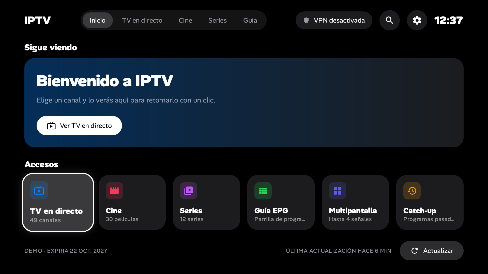
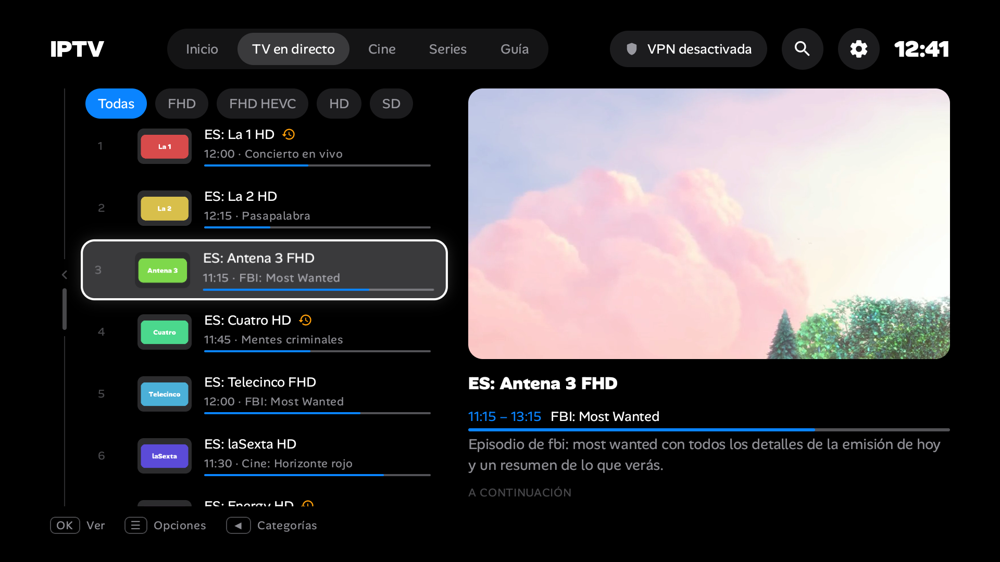
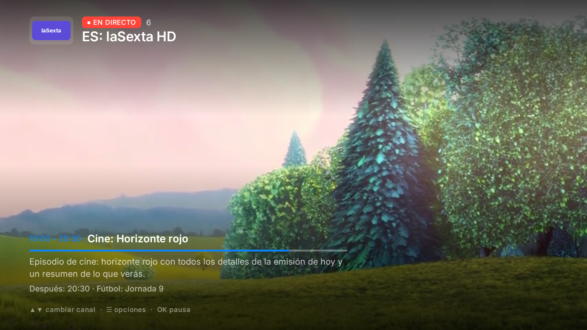
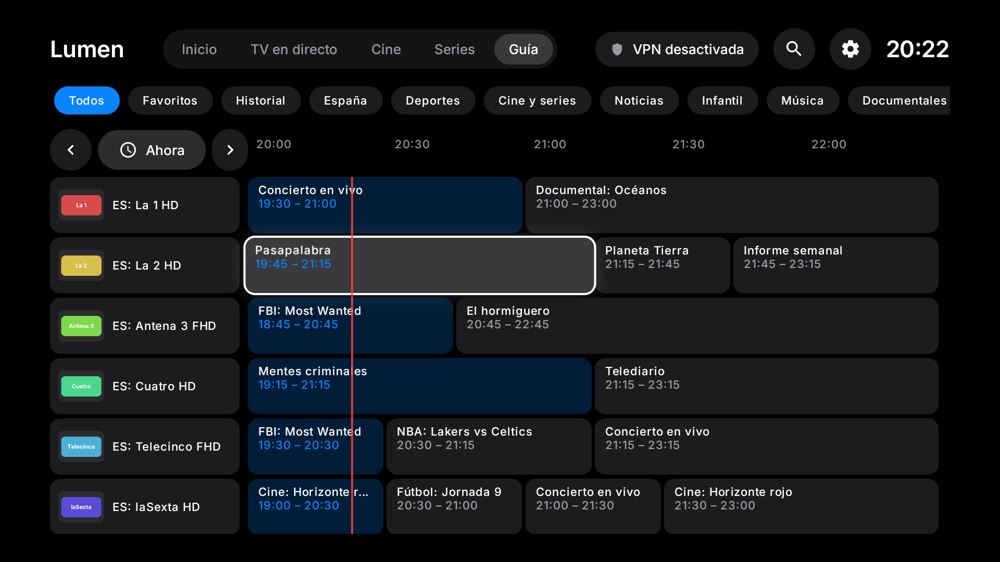
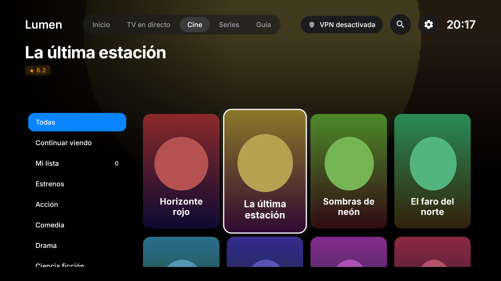
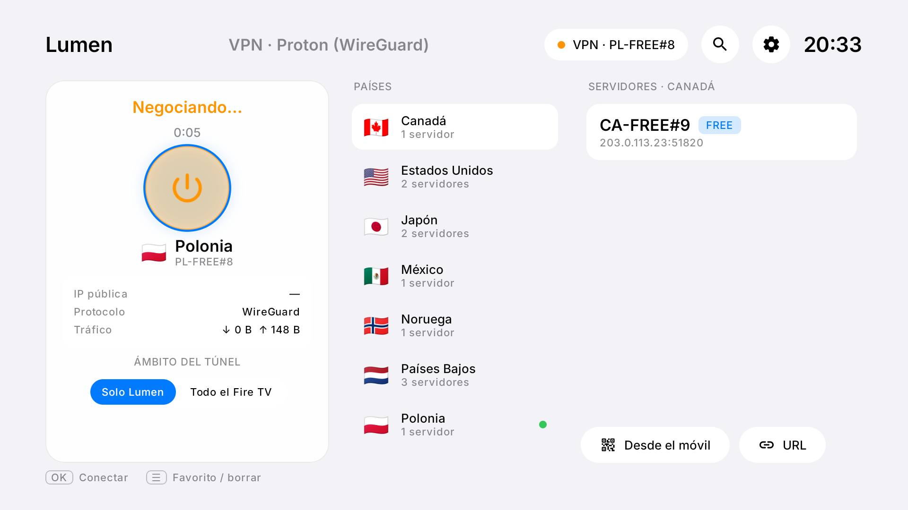
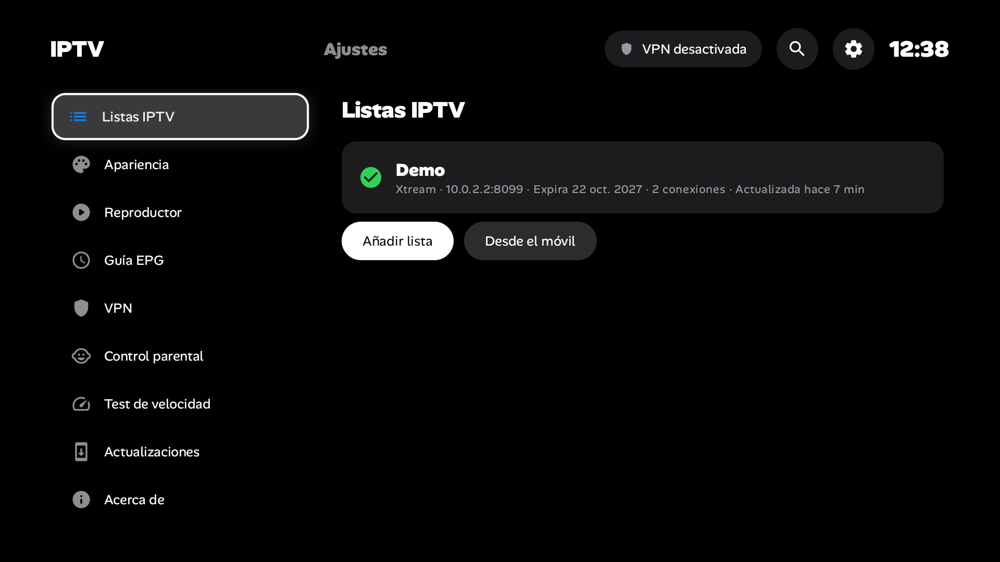

# IPTV (proyecto Lumen TV)

Reproductor IPTV propio para **Amazon Fire TV / Fire TV Stick**, con diseño minimalista inspirado en Apple tvOS (tema oscuro) y **VPN de Proton integrada**: eliges país y servidor desde la propia app, sin abrir Proton VPN antes ni después.

> En el Fire TV la app se llama **IPTV**; «Lumen» es solo el nombre interno del código (`app.lumentv`). No incluye contenido. Reproduce las listas IPTV que tú configures (Xtream Codes o M3U).

## Funciones

| | |
|---|---|
| 📺 **TV en directo** | Categorías plegables, filtro por calidad (FHD, FHD HEVC, HD, SD), favoritos, historial, previsualización con sonido, EPG actual y siguiente, zapping con ▲▼ |
| 🎬 **Cine y series** | Rejilla de pósters, ficha con sinopsis y reparto, temporadas/episodios, "Continuar viendo", auto-siguiente episodio |
| 🗓️ **Guía EPG** | Parrilla por categoría; EPG del proveedor + **fuentes XMLTV externas** (.xml/.gz) + desfase horario |
| ⏪ **Catch-up** | Programas pasados de los canales con archivo, también desde la guía |
| 🔲 **Multipantalla** | 6 disposiciones de 2 a 4 señales, audio en la que tenga el foco |
| 🔎 **Búsqueda maestra** | En canales, películas y series a la vez |
| 🛡️ **VPN integrada** | WireGuard con tus servidores de Proton VPN agrupados por país, conexión rápida, IP pública, tráfico, ámbito **"Solo Lumen"** o **"Todo el Fire TV"**, autoconectar al abrir y desconectar al salir |
| 🎛️ **Reproductor** | Pistas de audio y subtítulos, modo de imagen, búfer, formato TS/HLS, User-Agent, reproductor externo (VLC, MX, Kodi) |
| 🔒 **Control parental** | PIN de 4 dígitos y bloqueo por categoría |
| ⚡ **Test de velocidad** | Descarga y latencia (a través de la VPN si está activa) |
| 📱 **Configurar desde el móvil** | QR en la tele → página web para subir los `.conf` y la lista sin teclear con el mando |
| 🔄 **Actualizaciones OTA** | La app avisa e instala nuevas versiones publicadas en GitHub Releases |

Todo lo "Premium" de IPTV Smarters Pro está incluido sin pagar.

## Diseño y capturas

Diseñado en Google Stitch (proyecto *Lumen TV — IPTV para Fire TV*): bocetos en [`design/stitch/`](design/stitch/) y tokens en [DESIGN.md](DESIGN.md).

Capturas de la app real (emulador Android TV con datos de demostración):

| | |
|---|---|
|  |  |
|  |  |
|  |  |
|  |  |

---

## 1. Instalación en el Fire TV Stick (primera vez)

### Preparar el Fire TV (una sola vez)

1. **Ajustes → Mi Fire TV → Acerca de** → pulsa 7 veces sobre el nombre del dispositivo hasta que diga que eres desarrollador.
2. **Ajustes → Mi Fire TV → Opciones para desarrolladores**:
   - **Depuración ADB** → Activado (para instalar desde el PC).
   - **Instalar apps desconocidas** → activa **Downloader** (si usas ese método).
3. Apunta la IP del Fire TV: **Ajustes → Mi Fire TV → Acerca de → Red**.

### Opción A — Desde el PC por ADB (recomendada)

```bash
adb connect 192.168.1.50:5555
```

La primera vez el Fire TV muestra "¿Permitir depuración USB?" → marca *Permitir siempre* y acepta. Después:

```bash
adb install -r app-release.apk
```

### Opción B — Con la app Downloader

1. Instala **Downloader** (de AFTVnews) desde la Appstore de Amazon.
2. Abre Downloader y escribe la URL del APK (la de la última GitHub Release, o un enlace acortado).
3. Pulsa **Instalar**. Al terminar, borra el APK descargado cuando Downloader lo ofrezca.

> Si el repositorio es privado, Downloader no puede bajar el APK de GitHub: usa ADB o súbelo a otro sitio.

### Primer arranque

1. Lumen aparece en **Tus apps y juegos** (muévela a la fila de inicio con ☰ → Mover).
2. Añade tu lista: **Xtream Codes** (servidor, usuario, contraseña — los mismos de IPTV Smarters) o **M3U**. Más cómodo: *Configurar desde el móvil* y escanea el QR.
3. La carga inicial del catálogo tarda de segundos a un par de minutos según el proveedor; el progreso se ve en Inicio.

---

## 2. Configurar la VPN (Proton VPN, cuenta gratuita)

Proton no ofrece una API pública, así que Lumen usa los **ficheros WireGuard** que generas en tu cuenta. Cada fichero = un servidor.

1. En el móvil/PC entra en **account.protonvpn.com → Descargas → Configuración de WireGuard**.
2. Elige **Plataforma: Android**, el **país** y el **servidor** (en la cuenta gratuita, los que llevan *FREE*: Países Bajos, Japón, EE. UU., Polonia, Rumanía, Suiza, Noruega, Singapur, México, Canadá…). Pulsa **Crear** y descarga el `.conf`.
3. Repite con todos los servidores que quieras tener disponibles.
4. En Lumen: **VPN → Añadir desde el móvil**, escanea el QR y sube los `.conf` (puedes seleccionar varios a la vez).
5. Aparecerán agrupados por país con su bandera. Elige país → servidor → **OK**. La primera vez Android pide permiso para crear la VPN: acepta.

**Ámbito del túnel**

- **Solo Lumen** (por defecto): solo el tráfico de Lumen va por la VPN. Netflix, Prime, YouTube… siguen sin VPN.
- **Todo el Fire TV**: equivale a lo que hacías con la app de Proton.

Opciones en **Ajustes → VPN**: conectar al abrir Lumen, desconectar al salir.

> Alternativa sin móvil: pon los `.conf` en `vpn-configs/`, `LUMEN_BUNDLE_VPN_CONFIGS=true` en `.env` y compila. Se importan solos al abrir la app (el APK contendrá tus claves: no lo compartas).

---

## 3. Actualizaciones

### Cómo publico una versión nueva

1. Sube `lumen.versionCode` (+1) y `lumen.versionName` en `gradle.properties`.
2. Commit, tag y push:

```bash
git tag v1.1.0
```

```bash
git push origin main --tags
```

3. GitHub Actions (`.github/workflows/release.yml`) compila, firma, y publica una Release con la versión de la tele (`lumen-1.1.0.apk` + `update.json`) y la del móvil (`lumen-mobile-1.1.0.apk` + `update-mobile.json`), cada manifiesto con su versión y SHA-256. Las dos apps salen siempre con el mismo número de versión.

Para probar los APK firmados antes de publicar: *Actions → Release → Run workflow*. Compila y firma igual, pero no crea ninguna Release: los APK quedan en el resumen del run (*Artifacts*).

Secrets necesarios en GitHub (*Settings → Secrets and variables → Actions*): `LUMEN_KEYSTORE_BASE64` (el `.jks` en base64), `LUMEN_KEYSTORE_PASSWORD`, `LUMEN_KEY_ALIAS`, `LUMEN_KEY_PASSWORD` y, si el repo es privado, `LUMEN_UPDATE_GITHUB_TOKEN`. Para generar el base64 en Windows:

```bash
base64 -w 0 keystore/lumen-release.jks > keystore.b64
```

### Cómo se actualiza el Fire TV

- Al abrir Lumen (como mucho cada 12 h) comprueba la última Release. Si hay versión nueva verás un aviso en Inicio.
- **Ajustes → Actualizaciones → Descargar e instalar**. La primera vez Fire OS pedirá permitir a Lumen *instalar apps desconocidas*: actívalo y vuelve a pulsar.
- También puedes actualizar desde el PC con `adb install -r` (conserva datos y ajustes).

### Instalar y actualizar en el móvil

- **Instalar**: en el móvil abre la última Release en GitHub, descarga `lumen-mobile-X.Y.Z.apk` y ábrelo. Android pedirá permitir *instalar apps desconocidas* al navegador (o a Archivos): actívalo y vuelve. Es una app aparte de la de la tele (`app.lumentv.mobile`).
- **Actualizar**: igual que en la tele, al abrir la app comprueba la última Release (como mucho cada 12 h) y muestra un aviso en Inicio; tócalo, o ve a *Ajustes → Acerca de → Instalar*. La primera vez Android pide permitir a IPTV instalar apps.

> ⚠️ Todas las versiones deben ir firmadas con el **mismo keystore** (`keystore/lumen-release.jks`). Guarda una copia de ese fichero y de su contraseña fuera del ordenador. Si se pierde, habrá que desinstalar Lumen (perdiendo ajustes) para instalar una versión firmada con otra clave.

---

## 4. Compilar

Requisitos: JDK 17 y Android SDK (API 35). No hace falta Docker ni Android Studio.

```bash
cp .env.example .env
```

```bash
./gradlew assembleTvRelease
```

El APK queda en `app/build/outputs/apk/tv/release/app-tv-release.apk`. Sin keystore configurado se firma con la clave debug (vale para probar, no para actualizar).

Comandos útiles:

```bash
./gradlew assembleTvDebug testTvDebugUnitTest
./gradlew assembleMobileDebug   # versión móvil (ver docs/PLAN-MOVIL.md)
./gradlew assembleMobileRelease # APK del móvil: app/build/outputs/apk/mobile/release/app-mobile-release.apk
```

Para probar sin tu lista real hay un panel Xtream de demostración en [`tools/mock-xtream/`](tools/mock-xtream/README.md).

## Configuración (`.env`)

Ver [.env.example](.env.example): valores de lista precargados, empaquetado de `.conf`, repo de actualizaciones, firma, URL del test de velocidad y puerto del servidor de importación. Todo opcional.

## Manejo con el mando

| Tecla | Acción |
|---|---|
| ◀ ▲ ▼ ▶ | Navegar · en directo ▲▼ cambia de canal · en VOD ◀ −10 s / ▶ +30 s |
| OK | Abrir / reproducir · en el reproductor: mostrar info y pausar |
| ☰ | Opciones: favoritos, bloquear categoría, pistas de audio/subtítulos, formato de imagen |
| Atrás | Volver · en el reproductor: ocultar info y salir |
| Inicio | Cierra la app y vuelve al menú del Fire TV |

## Documentación

- [ARCHITECTURE.md](ARCHITECTURE.md) — cómo está hecho.
- [DESIGN.md](DESIGN.md) — sistema de diseño.
- [CLAUDE.md](CLAUDE.md) — guía para desarrollar con Claude Code.
- [docs/PLAN.md](docs/PLAN.md) — plan de implementación original.

## Licencias de terceros

AndroidX / Jetpack Compose / Media3 (Apache 2.0), WireGuard Android tunnel (Apache 2.0), OkHttp (Apache 2.0), Coil (Apache 2.0), ZXing (Apache 2.0), Alan Sans (SIL OFL 1.1, licencia en `docs/licencias/AlanSans-OFL.txt`). Proton VPN es marca de Proton AG; Lumen no está afiliado a Proton ni a IPTV Smarters.
